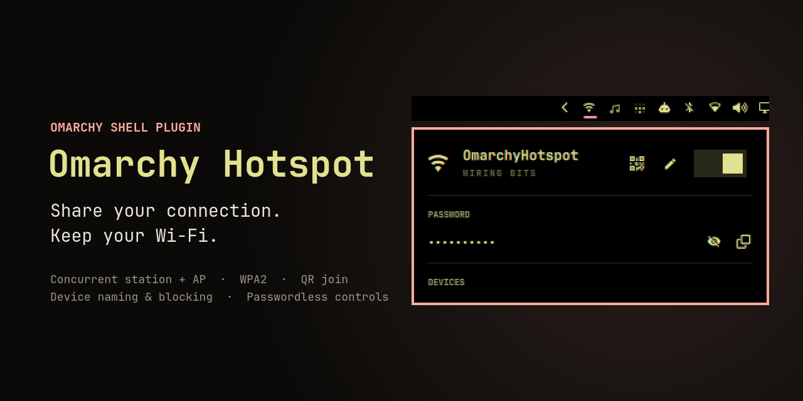

<p align="center">
  
</p>

<h1 align="center">Omarchy Hotspot</h1>

<p align="center">
  <strong>Share your connection. Keep your Wi-Fi.</strong><br>
  A one-click Wi-Fi hotspot for the Omarchy bar that never drops your current network.
</p>

<p align="center">
  
  
  
  
</p>

---

Omarchy Hotspot turns your laptop into a WPA2 access point named
`OmarchyHotspot` while it stays connected to the network it is already on.
Phones and tablets join with a QR code, and everything (status, password,
connected devices) lives in a native-style panel in your bar.

## Highlights

| | |
|---|---|
| **Wi-Fi stays up** | The hotspot runs on a virtual `ap0` interface next to your station interface. No disconnects, no radio juggling. |
| **Scan to join** | A scannable `WIFI:` QR code in the panel. Point any phone camera at it. |
| **One panel for everything** | Hero toggle, live uplink/channel/client status, reveal/copy password, edit name and password, keyboard navigation (`j`/`k`, `Enter`, `Esc`). |
| **Native bar controls** | Left click opens the panel, right click toggles the hotspot, middle click refreshes. |
| **Knows your devices** | Names clients from DHCP, mDNS, NetBIOS, and hardware vendor data, with a local rename fallback for unknown devices. |
| **Device control** | Disconnect a client once, block it persistently, or unblock it later. |
| **Shares any uplink** | NAT follows the default route: Wi-Fi, Ethernet, phone tether, or VLAN. |
| **No password prompts in daily use** | A narrowly scoped polkit rule lets the panel drive one root-owned helper without prompting. |

## Requirements

- **Omarchy** (or Hyprland + Quickshell with the Omarchy shell)
- `iw`, `nmcli`, `qrencode`, `python3`, `wl-copy` (wl-clipboard)
- `hostapd` and `dnsmasq` (`install.sh` installs these with pacman)
- A Wi-Fi adapter whose driver supports **concurrent station + AP** interfaces

Check your adapter:

```sh
iw list | grep -A3 "valid interface combinations"
# you need an entry that allows both "managed" and "AP"
```

The AP mirrors the station's channel and channel width automatically, which
single-radio adapters require. It stays off 5 GHz radar (DFS) channels,
which an access point may use only after a radar check of a minute or more:
when the station's block includes one, as every 160 MHz block does in many
countries, the AP uses the widest narrower block around the same channel
(usually 80 MHz). When the station's own channel is a DFS channel, the panel
says so and the hotspot stays off; Wi-Fi stays connected.

| Adapter | Driver | Status |
|---|---|---|
| Intel AX200 / AX210 | `iwlwifi` | Supports station + AP concurrency |
| Realtek RTL8822CE | `rtw88_8822ce` | Driver advertises station + AP |
| Realtek RTL8723DE | `rtw88_8723de` | Not with the stock driver; see note below |

> **RTL8723DE note.** The in-kernel `rtw88` driver advertises station + AP
> concurrency only for RTL8822C, so on RTL8723DE `iw list` shows no
> combinations and hostapd fails with `Device or resource busy`. Enabling the
> same single-channel combination for RTL8723D in `rtw88` (a one-line driver
> change built as a local module override) has been verified to keep Wi-Fi
> connected while hosting this hotspot on kernel 7.2.5. This plugin does not
> install or modify kernel drivers.

When an adapter cannot create the concurrent AP interface, the panel shows the
driver and PHY that refused it. It never falls back to a mode that disconnects
your Wi-Fi.

## Installation

The repository root is the Omarchy plugin (`manifest.json` at the root). Setup
takes two steps.

**1. Add the bar widget**

```sh
omarchy plugin add https://github.com/chillboy0101/omarchy-hotspot --yes
omarchy plugin enable io.github.chillboy0101.omarchy-hotspot --section right
```

**2. Install the system helper** (asks for your password once)

```sh
git clone https://github.com/chillboy0101/omarchy-hotspot.git
cd omarchy-hotspot
./install.sh
```

`install.sh`:

1. Verifies every installed file against the committed `payload.sha256`
   *before* asking for your password, and stops on any mismatch, symlink, or
   non-regular file
2. Hands the verified bytes to the root stage over a pipe. The authorization
   request carries the installer and manifest SHA-256, and root re-checks both
   plus every file digest without reading from the checkout
3. Installs `hostapd` and `dnsmasq` (pacman)
4. Installs the helper to `/usr/local/bin/` and its root-owned support files to
   `/usr/local/lib/`, each through an exclusive temporary file and atomic rename
5. Migrates existing hotspot settings to root-owned `600` files without
   changing their values
6. Installs the polkit rule (passwordless `pkexec` for the helper only, for
   your user only)
7. Tells NetworkManager to leave `ap0` alone

## Usage

1. Click the hotspot icon in the bar to open the panel (or right-click to
   toggle straight away).
2. Flip the switch (or press `Enter`). The panel shows the uplink, channel,
   and connected clients.
3. Join from a phone by scanning the QR code, or manually:
   - **Network:** `OmarchyHotspot` (editable)
   - **Password:** reveal it (it hides again after a few seconds) or copy it
     from the panel
4. Toggle off when you are done. Your Wi-Fi connection was never interrupted.

**Editing.** The pencil opens one form for the hotspot name and an optional new
password. Leaving the password blank keeps the current one. Passwords must be
8–63 printable ASCII characters.

**Devices.** Connected devices show their best local name with MAC/IP, signal,
and connection time. **Rename** appears only when discovery returns
*Unknown device* or a generic vendor label. **Disconnect** removes a device
once (it can rejoin because it knows the password). **Block** disconnects it and
keeps it out across hotspot restarts, and **Unblock** under *Blocked devices*
lets it back in. Phones may hide their Settings name or use a private MAC, so
automatic model detection is best-effort.

## How it works

```
 phone ── WPA2 ──▶ ap0 (hostapd + dnsmasq) ──NAT──▶ default route ──▶ internet
                    │                                     ▲
                    └──────── same radio, same channel ───┘
                               wlo1 / wlp… (your Wi-Fi, stays up)
```

- **hostapd** serves the AP on `ap0` as a transient systemd unit
  (`omarchy-hotspot.service`) with journald logging.
- **dnsmasq** hands out `10.42.0.10–200` and resolves DNS
  (`omarchy-hotspot-dns.service`).
- **iptables** provides NAT and forwarding, plus an explicit INPUT accept on
  `ap0`, since UFW's default DROP policy would otherwise block client DHCP/DNS.
- The bar widget (`io.github.chillboy0101.omarchy-hotspot`) polls the helper
  through `pkexec` and renders the QR matrix in the same format as
  `omarchy.wifiqr`.

## Security

The helper crosses a passwordless privilege boundary, so it is deliberately
small and strict:

- Polkit authorizes only `/usr/local/bin/omarchy-hotspot-helper`, only for the
  user who ran the installer, and the helper exposes a closed subcommand list.
- The helper clears its environment, sets `PATH=/nonexistent`, and calls tools
  through a fixed absolute-path allowlist.
- Privileged state lives in root-owned `700`/`600` files written through
  no-follow directory descriptors with locking and atomic replacement.
- Secrets travel over bounded stdin, never argv. QML never builds shell
  commands, and every child process has a deadline and an output cap.
- The installer verifies a committed SHA-256 manifest before elevation, and CI
  pins its actions to full commit SHAs.

Details are in [docs/SECURITY.md](docs/SECURITY.md).

## Troubleshooting

| Symptom | What to check |
|---|---|
| Panel says the adapter cannot create a concurrent AP interface | Your driver does not advertise station + AP. Check `iw list` (see [Requirements](#requirements)). |
| `Device or resource busy` in `journalctl -u omarchy-hotspot` | Same cause: the driver allows only one active interface. |
| Phone cannot see the network | `journalctl -u omarchy-hotspot` should show `AP-ENABLED`. Make sure the station is connected so the AP can mirror its channel. |
| Panel says Wi-Fi uses a radar (DFS) channel | The network you are connected to is on a DFS channel (for example 52-64 or 100-144). Connect to a 2.4 GHz network or a 5 GHz network on another channel, or set your router to one. |
| Connects but no internet | `iptables -L INPUT -n` and `iptables -t nat -L POSTROUTING -n`. The helper inserts an `ap0` ACCEPT and a MASQUERADE rule. |
| No IP address on the phone | `journalctl -u omarchy-hotspot-dns` should show DISCOVER → OFFER → ACK. |
| Toggle does nothing or asks for a password | The polkit rule in `/etc/polkit-1/rules.d/50-omarchy-hotspot.rules` must name your user. Rerun `./install.sh`. |

## Removal

```sh
omarchy plugin remove io.github.chillboy0101.omarchy-hotspot --yes   # bar widget
sudo rm /usr/local/bin/omarchy-hotspot-helper                        # system helper
sudo rm /usr/local/lib/omarchy-hotspot-secure-state
sudo rm /usr/local/lib/omarchy-hotspot-device-identification.sh
sudo rm /usr/local/lib/omarchy-hotspot-discover-device.sh
sudo rm /usr/local/lib/omarchy-hotspot-lease-event.sh
sudo rm /etc/polkit-1/rules.d/50-omarchy-hotspot.rules
sudo rm /etc/NetworkManager/conf.d/99-unmanaged-ap0.conf
nmcli general reload
sudo rm -r /var/lib/omarchy-hotspot          # optional: saved name, password, device names
sudo pacman -Rns hostapd dnsmasq             # optional: if nothing else uses them
```

## Project layout

```
manifest.json          Omarchy plugin manifest
plugin/
├── Panel.qml          bar button and panel UI
├── run-bounded.py     process-group deadline and output limits
├── copy-secret.py     bounded stdin-to-clipboard bridge
└── qr.sh              bounded stdin-to-QR matrix generator
src/
├── omarchy-hotspot-helper   root helper (closed subcommand allowlist)
├── secure-state.py          no-follow atomic state storage
├── install-payload.py       digest-verified installer
└── *.sh                     device identification and DHCP lease hooks
config/                polkit rule and NetworkManager exemption
payload.sha256         digests of every file the installer writes
tests/                 security, installer, and behavior tests
```

## Credits

Built for the [Omarchy](https://github.com/basecamp/omarchy) desktop by
Basecamp and its Quickshell shell. The bar widget follows the structure of
Omarchy's built-in `omarchy.network` widget, and the QR generator uses the same
module format as `omarchy.wifiqr`.

Powered by [hostapd](https://w1.fi/hostapd/),
[dnsmasq](https://thekelleys.org.uk/dnsmasq/doc.html),
[NetworkManager](https://networkmanager.dev/),
[Quickshell](https://quickshell.org/), and
[qrencode](https://fukuchi.org/works/qrencode/).

## Contributors

| Contributor | Role |
|---|---|
| **[Wis-kal](https://github.com/chillboy0101)** (`@chillboy0101`) | Owner and maintainer |
| **[Muhammad Dicky Isra](https://github.com/DaDecky)** (`@DaDecky`) | Scoped IPv6 resolver fix |
| **[JunaidIRF](https://github.com/JunaidIRF)** (`@JunaidIRF`) | Inline SSID editor and popup overflow fix |

Contributions are welcome. See [CONTRIBUTING.md](CONTRIBUTING.md).

## License

[MIT](LICENSE) © 2026 Wis-kal
