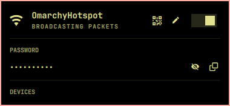

<p align="center">
  
</p>

<h1 align="center">Omarchy Hotspot</h1>

<p align="center">
  Concurrent Wi-Fi hotspot for the Omarchy desktop.<br>
  Share your connection without disconnecting from it.
</p>

<p align="center">
  <a href="https://plugins.omarchy.org/plugin.html?id=io.github.chillboy0101.omarchy-hotspot"></a>
  
  
  
  
  
  
</p>

<p align="center">
  <a href="#installation">Installation</a> &nbsp;·&nbsp;
  <a href="#usage">Usage</a> &nbsp;·&nbsp;
  <a href="#security">Security</a> &nbsp;·&nbsp;
  <a href="#troubleshooting">Troubleshooting</a> &nbsp;·&nbsp;
  <a href="#support">Support</a>
</p>

---

## Table of contents

- [Overview](#overview)
- [Key capabilities](#key-capabilities)
- [Screenshots](#screenshots)
- [System requirements](#system-requirements)
- [Hardware compatibility](#hardware-compatibility)
- [Installation](#installation)
- [Usage](#usage)
- [Architecture](#architecture)
- [Security](#security)
- [Operations](#operations)
- [Troubleshooting](#troubleshooting)
- [Uninstallation](#uninstallation)
- [Support](#support)
- [Contributing](#contributing)
- [Acknowledgements](#acknowledgements)
- [License](#license)

## Overview

Omarchy Hotspot turns an Omarchy laptop into a WPA2-protected Wi-Fi access
point while the laptop stays connected to its current network. The access point
runs on a virtual interface (`ap0`) alongside the existing station interface, so
the upstream connection is never dropped while clients are being served.

The plugin is delivered as an Omarchy bar widget
(`io.github.chillboy0101.omarchy-hotspot`) backed by a small, root-owned system
helper. Day-to-day operation (starting, stopping, sharing credentials, and
managing clients) happens entirely from the bar, without password prompts.

## Key capabilities

| Capability | Description |
|---|---|
| Concurrent operation | Hosts the access point and keeps the existing Wi-Fi connection active on the same adapter. |
| Modern Wi-Fi | Advertises 802.11n (HT) and, on 5 GHz, 802.11ac (VHT) at the station's channel width. |
| Automatic channel alignment | Mirrors the station's channel and channel width, which single-radio adapters require. |
| Any uplink | Network address translation follows the default route: Wi-Fi, Ethernet, USB tethering, or VLAN. |
| QR onboarding | Displays a standard `WIFI:` QR code that phone cameras join directly. |
| Credential management | Reveal (auto-hides), copy, and change the network name and passphrase from the panel. |
| Client visibility | Lists connected clients with name, MAC/IP, signal, and session time, using DHCP, mDNS, NetBIOS, and vendor data. |
| Client control | Disconnect a client once, block it persistently, or unblock it later. |
| Native integration | Omarchy-style panel with mouse and keyboard controls and theme-aware styling. |
| Hardened privilege boundary | Narrow polkit rule, closed helper command set, atomic root-owned state, and a digest-verified installer. |

## Screenshots

<p align="center">
  <br>
  <sub>Hotspot panel opened from the Omarchy bar with the access point active.</sub>
</p>

## System requirements

| Component | Requirement |
|---|---|
| Operating system | Omarchy (Arch Linux, Hyprland, and the Omarchy shell) |
| Installed by the installer | `hostapd`, `dnsmasq` |
| Provided by Omarchy | NetworkManager (`nmcli`), `iw`, `iptables`, `polkit`, `qrencode`, `python3`, `wl-clipboard` |
| Privileges | One administrator authentication during installation |
| Wi-Fi hardware | A driver that supports concurrent station (managed) and AP interfaces |

Confirm adapter support before installing:

```sh
iw list | grep -A3 "valid interface combinations"
# Look for an entry that allows both "managed" and "AP".
```

## Hardware compatibility

| Adapter | Driver | Status |
|---|---|---|
| Intel AX200 / AX210 | `iwlwifi` | Supported: station + AP concurrency |
| Realtek RTL8822CE | `rtw88_8822ce` | Driver advertises station + AP |
| Realtek RTL8723DE | `rtw88_8723de` | Not supported by the stock driver (see note) |

> **Note:** The in-kernel `rtw88` driver advertises station + AP concurrency only for
> RTL8822C. On RTL8723DE, `iw list` shows no interface combinations and hostapd
> fails with `Device or resource busy`. Enabling the same single-channel
> combination for RTL8723D in `rtw88` (a one-line driver change built as a local
> module override) has been verified to keep Wi-Fi connected while hosting this
> hotspot on kernel 7.2.5. This plugin does not install or modify kernel drivers.

When an adapter cannot create the concurrent interface, the panel reports the
driver and PHY that refused it. The plugin never falls back to a mode that
disconnects the station.

### Channel selection

The access point mirrors the station's channel and channel width, which
single-radio adapters require. It avoids channels on which hostapd cannot start
an access point:

- **Radar (DFS) channels** in 5 GHz, which require a radar check of a minute or
  more before transmitting.
- **Disabled or "no IR" channels**, as reported by `iw phy` for the current
  regulatory domain.
- **6 GHz channels**, where an access point must use WPA3 (SAE); the hotspot
  uses WPA2.

When the station's channel block includes such a channel, as every 160 MHz
block does in many countries, the access point uses the widest narrower block
around the same channel (usually 80 MHz). When the station's own channel is
affected, the panel explains why and the hotspot stays off. The Wi-Fi
connection is never interrupted.

## Installation

Omarchy Hotspot is listed in the [Omarchy plugin marketplace](https://plugins.omarchy.org/plugin.html?id=io.github.chillboy0101.omarchy-hotspot).
Installation has two parts: the bar widget and the system helper.

### Step 1. Add the bar widget

```sh
omarchy plugin add https://github.com/chillboy0101/omarchy-hotspot --yes
omarchy plugin enable io.github.chillboy0101.omarchy-hotspot --section right
```

### Step 2. Install the system helper

```sh
git clone https://github.com/chillboy0101/omarchy-hotspot.git
cd omarchy-hotspot
./install.sh
```

You are asked for your password once.

### Changes made by the installer

| Path | Purpose | Owner / mode |
|---|---|---|
| `/usr/local/bin/omarchy-hotspot-helper` | Privileged helper invoked by the panel | `root` / `0755` |
| `/usr/local/lib/omarchy-hotspot-secure-state` | No-follow, atomic state storage | `root` / `0755` |
| `/usr/local/lib/omarchy-hotspot-device-identification.sh` | Client name resolution | `root` / `0644` |
| `/usr/local/lib/omarchy-hotspot-lease-event.sh` | DHCP lease hook | `root` / `0755` |
| `/usr/local/lib/omarchy-hotspot-discover-device.sh` | Background client discovery | `root` / `0755` |
| `/etc/polkit-1/rules.d/50-omarchy-hotspot.rules` | Passwordless `pkexec` for the helper, installing user only | `root` / `0644` |
| `/etc/NetworkManager/conf.d/99-unmanaged-ap0.conf` | Keeps NetworkManager off `ap0` | `root` / `0644` |
| `/var/lib/omarchy-hotspot/` | Network name, passphrase, client names, block list | `root` / `0700`, files `0600` |

The installer also installs `hostapd` and `dnsmasq` with `pacman --needed`.
Existing settings are migrated without changing their values.

### Installer integrity

1. Before requesting privileges, every file to be installed is read once
   through no-follow descriptors and checked against the committed
   `payload.sha256`. Any mismatch, symlink, or non-regular file stops the
   installation.
2. The authorization request carries the SHA-256 of the installer and of the
   manifest. The verified bytes are passed to the privileged stage over a pipe;
   root never reads from the user-writable checkout.
3. The privileged stage re-verifies every digest, then writes each file through
   root-owned directory descriptors using an exclusive temporary file,
   `fsync`, and an atomic rename.

### Verify the installation

```sh
omarchy plugin list | grep omarchy-hotspot
pkexec /usr/local/bin/omarchy-hotspot-helper status
# Expected: "off<TAB>OmarchyHotspot", with no password prompt.
```

## Usage

### Controls

| Action | Mouse (bar icon) | Keyboard (panel open) |
|---|---|---|
| Open or close the panel | Left click | `Esc` closes |
| Start or stop the hotspot | Right click | `Enter` on the switch |
| Refresh status and clients | Middle click | — |
| Move between items | — | `j` / `k` or arrow keys |
| Activate the selected item | — | `Enter` |

### Connect a device

1. Start the hotspot from the bar or the panel switch.
2. Scan the QR code shown in the panel, or join manually:
   - **Network:** `OmarchyHotspot` (configurable)
   - **Passphrase:** reveal or copy it from the panel. A revealed passphrase
     hides again after a few seconds.
3. Stop the hotspot when finished. The laptop's own connection remains active
   throughout.

### Change the network name or passphrase

Select the edit control to open a single form for the network name and an
optional new passphrase. Leave the passphrase empty to keep the current one.
Passphrases must be 8–63 printable ASCII characters. Connected clients
reconnect with the new credentials after the access point restarts.

### Manage connected devices

Each client shows its best available local name with MAC/IP, signal strength,
and connection time. A rename option appears only for clients reported as
*Unknown device* or with a generic vendor label.

- **Disconnect** removes a client once. It can rejoin with the passphrase.
- **Block** disconnects a client and keeps it out across restarts.
- **Unblock**, under *Blocked devices*, restores access.

Phones may withhold their device name or use a randomized MAC address, so
automatic identification is best-effort.

## Architecture

```
  Client device                Omarchy laptop
 ┌──────────────┐    WPA2     ┌───────────────────────────────────────────┐
 │ phone/tablet │ ──────────▶ │ ap0       hostapd  (omarchy-hotspot)      │
 └──────────────┘             │           dnsmasq  (omarchy-hotspot-dns)  │
                              │              │ NAT (iptables)             │
                              │              ▼                            │
                              │ default route ──▶ upstream network        │
                              │ wlo1 / wlp…   station link, stays up      │
                              └───────────────────────────────────────────┘
```

| Component | Role |
|---|---|
| Bar widget (`plugin/Panel.qml`) | User interface. Calls the helper through `pkexec` via a bounded process runner. |
| System helper (`omarchy-hotspot-helper`) | Root-side control with a closed command set: `status`, `read-password`, `clients`, `blocked`, `toggle`, `set-password`, `set-ssid`, `set-device-alias`, `disconnect-device`, `block-device`, `unblock-device`. |
| hostapd | Access point on `ap0`, run as the transient unit `omarchy-hotspot.service`. |
| dnsmasq | DHCP (`10.42.0.10`–`10.42.0.200`) and DNS for clients, run as `omarchy-hotspot-dns.service`. |
| iptables | NAT, forwarding, and an explicit `ap0` input rule so a default-deny firewall does not block client DHCP/DNS. |
| Secure state (`secure-state.py`) | Root-owned, locked, atomic storage for settings and client records. |

The access point subnet is `10.42.0.0/24` with gateway `10.42.0.1`.

## Security

- Polkit authorizes only `/usr/local/bin/omarchy-hotspot-helper`, and only for
  the user who ran the installer.
- The helper exposes a closed command set, clears its environment, sets
  `PATH=/nonexistent`, and calls system tools through a fixed absolute-path
  allowlist.
- Privileged state is stored in root-owned `0700`/`0600` locations and written
  through no-follow directory descriptors with locking and atomic replacement.
- Network data such as SSIDs and client names is treated as untrusted text: the
  helper reads radio parameters only from fixed `iw` fields and accepts digits
  only.
- Secrets are passed over bounded standard input, never on the command line.
  The panel never constructs shell commands, and every child process runs with
  a deadline and an output limit.
- The installer verifies a committed SHA-256 manifest before elevation, and CI
  workflows pin third-party actions to full commit SHAs.

The complete security model is documented in [docs/SECURITY.md](docs/SECURITY.md).

**Reporting a vulnerability.** Please report suspected vulnerabilities
privately to the maintainer ([@chillboy0101](https://github.com/chillboy0101))
rather than in a public issue.

## Operations

| Task | Command |
|---|---|
| Check hotspot status | `pkexec /usr/local/bin/omarchy-hotspot-helper status` |
| Access point log | `journalctl -u omarchy-hotspot` |
| DHCP and DNS log | `journalctl -u omarchy-hotspot-dns` |
| Update the bar widget | `omarchy plugin update io.github.chillboy0101.omarchy-hotspot` |
| Update the system helper | `git pull && ./install.sh` (in your clone) |

Runtime files are kept in `/run/omarchy-hotspot/` and are recreated on each
start. Persistent settings are kept in `/var/lib/omarchy-hotspot/`.

## Troubleshooting

| Symptom | Resolution |
|---|---|
| The panel reports that the adapter cannot create a concurrent AP interface | The driver does not support station + AP. See [Hardware compatibility](#hardware-compatibility). |
| `Device or resource busy` in `journalctl -u omarchy-hotspot` | Same cause: the driver allows only one active interface. |
| Clients cannot see the network | Confirm `AP-ENABLED` in `journalctl -u omarchy-hotspot` and that the laptop is connected to Wi-Fi so the channel can be mirrored. |
| The panel reports a radar (DFS) channel | The network you are connected to uses a DFS channel (for example 52–64 or 100–144). Connect to a 2.4 GHz network or to a 5 GHz network on another channel, or change the router's channel. |
| The panel reports that regulatory rules forbid an access point (no IR), or that the radio cannot use the channel | The regulatory domain allows joining a network on that channel but not hosting one. If `iw reg get` shows `country 00`, every 5 GHz channel is no IR: set your country in `/etc/conf.d/wireless-regdom`. Otherwise connect to a network on another channel. |
| The panel reports a 6 GHz channel | A 6 GHz access point requires WPA3 (SAE). Connect to the router's 2.4 GHz or 5 GHz network instead. |
| Clients connect but have no internet | Check `iptables -L INPUT -n` and `iptables -t nat -L POSTROUTING -n` for the `ap0` accept and masquerade rules. |
| Clients do not receive an address | `journalctl -u omarchy-hotspot-dns` should show DISCOVER, OFFER, and ACK. |
| The bar asks for a password or the toggle does nothing | Rerun `./install.sh` so the polkit rule matches your user. |

## Uninstallation

```sh
omarchy plugin remove io.github.chillboy0101.omarchy-hotspot --yes
sudo rm /usr/local/bin/omarchy-hotspot-helper
sudo rm /usr/local/lib/omarchy-hotspot-secure-state
sudo rm /usr/local/lib/omarchy-hotspot-device-identification.sh
sudo rm /usr/local/lib/omarchy-hotspot-discover-device.sh
sudo rm /usr/local/lib/omarchy-hotspot-lease-event.sh
sudo rm /etc/polkit-1/rules.d/50-omarchy-hotspot.rules
sudo rm /etc/NetworkManager/conf.d/99-unmanaged-ap0.conf
nmcli general reload

# Optional
sudo rm -r /var/lib/omarchy-hotspot      # saved name, passphrase, and client names
sudo pacman -Rns hostapd dnsmasq         # only if nothing else uses them
```

## Support

Report bugs through [GitHub Issues](https://github.com/chillboy0101/omarchy-hotspot/issues/new?template=bug_report.md).
Please include your Omarchy version, kernel version, Wi-Fi adapter and driver
(`iw list` output helps), and the relevant `journalctl` logs.

## Contributing

Contributions are welcome. See [CONTRIBUTING.md](CONTRIBUTING.md) for the
development setup, coding standards, and the test suite. Changes to installed
files require regenerating `payload.sha256`, as described there.

### Repository layout

```
manifest.json              Omarchy plugin manifest
plugin/                    Bar widget (QML) and bounded process helpers
src/                       Root helper, secure state, installer, device discovery
config/                    Polkit rule and NetworkManager exemption
payload.sha256             Digests of every file the installer writes
tests/                     Security, installer, and behavior tests
docs/                      Security model and images
```

### Contributors

| Contributor | Contribution |
|---|---|
| [Carl Quist](https://github.com/chillboy0101) (`@chillboy0101`) | Owner and maintainer |
| [Muhammad Dicky Isra](https://github.com/DaDecky) (`@DaDecky`) | Scoped IPv6 resolver fix |
| [JunaidIRF](https://github.com/JunaidIRF) (`@JunaidIRF`) | Inline SSID editor and popup overflow fix |

## Acknowledgements

Built for [Omarchy](https://github.com/basecamp/omarchy) and its Quickshell-based
shell. The bar widget follows the conventions of Omarchy's built-in
`omarchy.network` widget, and the QR generator uses the same module format as
`omarchy.wifiqr`. The runtime relies on [hostapd](https://w1.fi/hostapd/),
[dnsmasq](https://thekelleys.org.uk/dnsmasq/doc.html),
[NetworkManager](https://networkmanager.dev/),
[Quickshell](https://quickshell.org/), and
[qrencode](https://fukuchi.org/works/qrencode/).

Omarchy Hotspot is a community plugin. It is not affiliated with or endorsed
by Basecamp or the Omarchy project.

## License

Released under the [MIT License](LICENSE). Copyright © 2026 Carl Quist.
